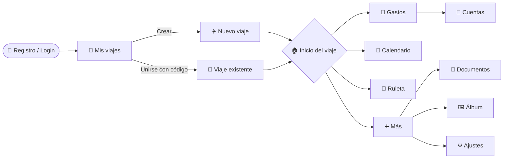
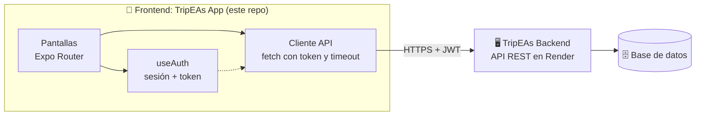

<div align="center">

# ✈️ TripEAs · Frontend

### Todo vuestro viaje en grupo, en una sola app

**Menos chats. Menos líos. Más viaje.**

**Frontend de TripEAs**: la aplicación móvil (Android, iOS y web) para organizar viajes en grupo: gastos compartidos, calendario de planes, listas, documentos, álbum de fotos y una ruleta para decidir cuando nadie se pone de acuerdo.

*Trabajo de Fin de Máster · Máster en Desarrollo de Aplicaciones Web*

> 🧩 Este repositorio contiene el **frontend**. La API REST está en **[TripEAs-backend](https://github.com/angelalop03/TripEAs-backend)**.

<br/>

[](https://angelalop03.github.io/TripEAs-Web/)
[](https://tripeas-app.expo.app)
[](https://expo.dev/artifacts/eas/SH_Nh3YTzG_zo9LCPQM961v6qIKLWCtsa7QNDgB4eek.apk)

<br/>


</div>

---

## 📖 Índice

- [El problema](#-el-problema)
- [Funcionalidades](#-funcionalidades)
- [Cómo se usa](#-cómo-se-usa)
- [Tecnologías](#️-tecnologías)
- [Arquitectura](#-arquitectura)
- [Detalles técnicos](#-detalles-técnicos)
- [Estructura del proyecto](#-estructura-del-proyecto)
- [Ejecutar en local](#-ejecutar-en-local)
- [Repositorios relacionados](#-repositorios-relacionados)

---

## 🤯 El problema

Organizar un viaje con amigos suele acabar repartido entre demasiados sitios:

| ❌ Antes de TripEAs | ✅ Con TripEAs |
|---|---|
| Cientos de mensajes sin leer en el grupo de WhatsApp | Los planes, en un calendario compartido |
| Un Excel de gastos con fórmulas rotas | Gastos registrados y cuentas calculadas solas |
| Nadie sabe quién le debe cuánto a quién | Liquidación automática con el mínimo de transferencias |
| Billetes y reservas perdidos en el correo | Documentos del viaje guardados y disponibles sin conexión |
| Fotos repartidas en cada móvil | Un álbum común para todo el grupo |
| Discusiones eternas para elegir restaurante | Una ruleta que decide por vosotros 🎡 |

**TripEAs** reúne todo eso en una sola app pensada para el grupo, no para una sola persona.

---

## ✨ Funcionalidades

### 🧳 Viajes

- **Crear un viaje** con nombre, fechas y foto de portada.
- **Unirse a un viaje** introduciendo un **código de invitación**.
- **Calendario general** con todos tus viajes: cada viaje tiene su color y, si dos se solapan, se marca con puntos debajo del día.
- **Ajustes del viaje**: el administrador puede cambiar nombre, portada y fechas. Cualquier participante puede ver y compartir el código.

### 👥 Participantes

- Invitar compartiendo el código del viaje.
- **Perfiles provisionales:** el administrador puede añadir a alguien solo con su nombre, aunque todavía no tenga cuenta. Así sus gastos se pueden apuntar desde el primer día.
- **Reclamar identidad:** cuando esa persona se registra, puede quedarse con su perfil provisional y todo su historial.

### 💸 Gastos y cuentas (estilo Tricount)

- Registrar quién ha pagado cada gasto y entre quién se reparte.
- Ver el **total gastado** del viaje y el listado de gastos.
- **Cuentas:** quién le debe a quién, calculado en el backend con un algoritmo de grafos que **minimiza el número de transferencias** necesarias para quedar en paz.

### 📅 Calendario de planes

- Organizar las actividades día a día con todo el grupo.
- Los próximos planes aparecen en la pantalla de inicio del viaje.

### 🎡 Ruleta de decisiones

- Crear una ruleta con las opciones que queráis (restaurantes, planes, quién conduce…).
- Girarla y dejar que decida. La rueda se dibuja con SVG para adaptarse a cualquier número de opciones.

### ✅ Listas compartidas

- Listas de tareas, de la compra o de equipaje para todo el grupo.
- Marcar elementos como completados para no duplicar esfuerzos.

### 📄 Documentos

- Subir billetes, reservas y seguros.
- **Disponibles sin conexión:** los PDFs se descargan y se guardan en el móvil para abrirlos aunque no haya internet (por ejemplo, en la puerta de embarque).

### 🖼️ Álbum

- Fotos y vídeos del viaje en un único sitio.
- Solo quien ha subido un archivo puede borrarlo.

### 👤 Perfil

- Registro e inicio de sesión.
- Elegir un avatar o subir foto de perfil.
- Cambiar la contraseña.

---

## 🧭 Cómo se usa



Dentro de cada viaje hay una **barra inferior con cinco pestañas**: Gastos, Calendario, Inicio, Ruleta y Más. Lo que no cabe en la barra (documentos, álbum, listas y ajustes) está en la pestaña **Más**.

---

## 🛠️ Tecnologías

| Herramienta | Para qué la uso |
|---|---|
| **React Native** | Una sola base de código para Android, iOS y web |
| **Expo** | Desarrollo, acceso a funciones del móvil y compilación |
| **Expo Router** | Navegación basada en archivos, con rutas tipadas y rutas dinámicas por viaje (`/viaje/[id]`) |
| **TypeScript** | Tipado de pantallas, componentes y respuestas de la API |
| **EAS Build** | Generar el APK y el bundle de producción en la nube |
| **AsyncStorage** | Guardar la sesión del usuario en el dispositivo |
| **expo-image-picker · expo-document-picker** | Elegir fotos y documentos para subirlos |
| **expo-file-system · expo-sharing** | Descargar documentos y abrirlos sin conexión |
| **react-native-svg** | Dibujar la rueda de la ruleta |
| **react-native-calendars** | Calendarios del viaje y general |
| **Reanimated · Gesture Handler · Haptics** | Animaciones, gestos y vibración al interactuar |
| **Figma** | Diseño de todas las pantallas antes de programarlas |

---

## 🏗️ Arquitectura



La app no guarda datos del viaje en local (salvo la sesión y los documentos descargados): todo se pide al **[backend de TripEAs](https://github.com/angelalop03/TripEAs-backend)**, una API REST propia desplegada en Render.

<details>
<summary><b>🔌 Ver los endpoints que consume la app</b></summary>

<br/>

| Módulo | Endpoints |
|---|---|
| **Auth** | `POST /auth/login` · `POST /auth/registro` · `POST /auth/cambiar-password` |
| **Usuarios** | `/usuarios/perfil` · `/usuarios/subir-foto-perfil` |
| **Viajes** | `/viajes/crear` · `/viajes/mis-viajes` · `/viajes/unirse` · `/viajes/subir-portada` · `/viajes/:id` |
| **Participantes** | `/participantes/:id` · `/participantes/anadir-fantasma` · `/participantes/reclamar-identidad` |
| **Gastos** | `/gastos/registrar` · `/gastos/:id` · `/gastos/:id/liquidacion` |
| **Calendario** | `/calendario/crear` · `/calendario/:id` |
| **Ruleta** | `/ruleta/crear` · `/ruleta/:id` · `/ruleta/:id/girar` |
| **Listas** | `/listas/crear` · `/listas/:id` · `/listas/items/anadir` · `/listas/items/:id/completar` |
| **Documentos** | `/documentos/subir` · `/documentos/:id` |
| **Álbum** | `/album/subir` · `/album/:id` |

</details>

---

## 💡 Detalles técnicos

<details>
<summary><b>🔐 Sesión y peticiones autenticadas</b></summary>

<br/>

Toda la comunicación con el backend pasa por un único cliente (`constants/Api.ts`):

- `fetchApi` para las rutas públicas (login y registro).
- `fetchConToken` añade automáticamente el token del usuario. Si el servidor responde **401**, cierra la sesión y lleva al login.
- Detecta si el cuerpo es un `FormData` (subida de fotos o documentos) para no forzar el `Content-Type` y que el backend pueda leer el archivo.

</details>

<details>
<summary><b>⏱️ Preparada para un servidor que "se duerme"</b></summary>

<br/>

El backend está en el plan gratuito de Render, que apaga el servidor tras un rato sin uso. La primera petición puede tardar 30-50 segundos en despertarlo.

**Solución:** las peticiones tienen un *timeout* de 45 segundos y la app distingue entre un **error de conexión** (el servidor no respondió) y un **error del servidor** (respondió con un fallo). Un fallo de red no cierra la sesión del usuario: solo se le avisa con un mensaje claro.

</details>

<details>
<summary><b>👻 Perfiles provisionales</b></summary>

<br/>

En un viaje real, no todo el mundo se instala la app el primer día. Para que los gastos cuadren igualmente, el administrador puede crear un **participante provisional** solo con su nombre. Cuando esa persona se registra, **reclama esa identidad** y hereda todo lo apuntado a su nombre.

</details>

<details>
<summary><b>🎨 Fiel al diseño de Figma</b></summary>

<br/>

Todas las pantallas se diseñaron primero en Figma sobre un marco de 393 px de ancho. En el código, las medidas se escalan según el ancho real del dispositivo, para que la app se vea igual en cualquier móvil.

</details>

<details>
<summary><b>📶 Documentos sin conexión</b></summary>

<br/>

Los PDFs del viaje se descargan con `expo-file-system` y se guardan en el dispositivo. Después se abren con `expo-sharing`, así que se pueden consultar sin internet: justo cuando más falta hacen.

</details>

<details>
<summary><b>🌍 Distintos entornos de compilación</b></summary>

<br/>

La URL del backend se configura con la variable `EXPO_PUBLIC_API_URL`. En `eas.json` hay tres perfiles:

| Perfil | Resultado | Backend |
|---|---|---|
| `development` | APK de desarrollo | Backend local en la red |
| `preview` | APK para probar | Backend en Render |
| `production` | App Bundle para la tienda | Backend en Render |

</details>

---

## 📁 Estructura del proyecto

```
TripEAs-app/
├── app/                          # Pantallas (rutas de Expo Router)
│   ├── index.tsx                 # Punto de entrada y redirección según sesión
│   ├── login.tsx · signup.tsx    # Autenticación
│   ├── (tabs)/index.tsx          # Mis viajes
│   ├── calendario.tsx            # Calendario general de todos los viajes
│   ├── ajustes-perfil.tsx        # Perfil del usuario
│   ├── ayuda.tsx                 # Acerca de TripEAs
│   └── viaje/
│       ├── [id]/                 # Pestañas del viaje
│       │   ├── index.tsx         # 🏠 Inicio: balance, participantes y próximos planes
│       │   ├── gastos.tsx        # 💸 Gastos
│       │   ├── calendario.tsx    # 📅 Planes del viaje
│       │   ├── elegir.tsx        # 🎡 Ruleta
│       │   └── mas.tsx           # ➕ Más secciones
│       ├── cuentas.tsx           # 🤝 Quién debe a quién
│       ├── listas.tsx            # ✅ Listas
│       ├── docs.tsx              # 📄 Documentos
│       ├── album.tsx             # 🖼️ Álbum
│       ├── participantes.tsx     # 👥 Añadir participantes
│       └── ajustes.tsx           # ⚙️ Ajustes del viaje
├── components/                   # Modales, barra inferior, ruleta, menú lateral…
├── constants/                    # Cliente API, colores, estilos, avatares
├── hooks/useAuth.tsx             # Contexto de sesión
├── assets/                       # Iconos, imágenes y avatares
├── app.json                      # Configuración de Expo
└── eas.json                      # Perfiles de compilación
```

---

## 🚀 Ejecutar en local

**Requisitos:** Node.js 20 o superior, npm y la app **Expo Go** en el móvil (o un emulador de Android / simulador de iOS).

```bash
# 1. Clonar el repositorio
git clone https://github.com/angelalop03/TripEAs-app.git
cd TripEAs-app

# 2. Instalar dependencias
npm install

# 3. (Opcional) Indicar qué backend usar
#    Por defecto apunta a un backend local en la red
export EXPO_PUBLIC_API_URL=https://tripeas-backend.onrender.com/api

# 4. Arrancar
npx expo start
```

Escanea el código QR con Expo Go, o pulsa `a` para Android, `i` para iOS o `w` para web.

| Comando | Descripción |
|---|---|
| `npm start` | Arranca el servidor de desarrollo de Expo |
| `npm run android` | Abre la app en Android |
| `npm run ios` | Abre la app en iOS |
| `npm run web` | Abre la versión web |
| `npm run lint` | Analiza el código |
| `eas build -p android --profile preview` | Genera un APK para probar |

---

## 🔗 Repositorios relacionados

| Repositorio | Descripción |
|---|---|
| 📱 **[TripEAs-app](https://github.com/angelalop03/TripEAs-app)** | Frontend: esta app móvil |
| 🖥️ **[TripEAs-backend](https://github.com/angelalop03/TripEAs-backend)** | API REST que da servicio a la app |
| 🌐 **[TripEAs-Web](https://github.com/angelalop03/TripEAs-Web)** | Web de presentación del proyecto, con descarga del APK |

---

<div align="center">

### 👩‍💻 Desarrollado por **Ángela López Oliva**

Trabajo de Fin de Máster · Máster en Desarrollo de Aplicaciones Web · Universidad Europea

[](https://github.com/angelalop03)
[](https://portfolio-v2-rosy-eight.vercel.app/)

⭐ Si te ha gustado, ¡déjale una estrella al repo!

</div>
