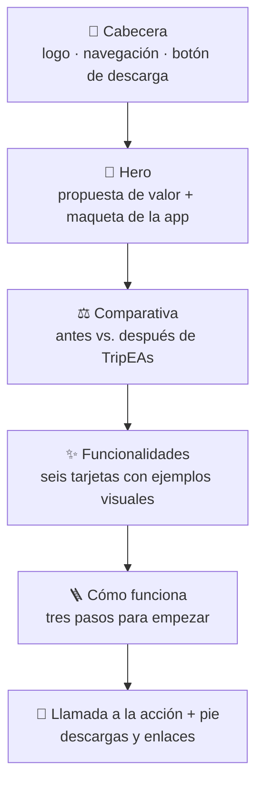
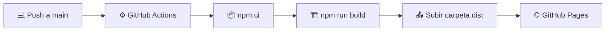

<div align="center">

# 🌐 TripEAs · Web de presentación

### La puerta de entrada a TripEAs

Landing page de **TripEAs**, la app para organizar viajes en grupo. Explica qué problema resuelve, enseña sus funcionalidades y lleva al usuario a descargar la app o a probarla en el navegador.

*Parte de mi Trabajo de Fin de Máster · Máster en Desarrollo de Aplicaciones Web*

<br/>

[](https://angelalop03.github.io/TripEAs-Web/)
[](https://github.com/angelalop03/TripEAs-app)

<br/>


</div>

---

## 📖 Índice

- [Qué es TripEAs](#-qué-es-tripeas)
- [Para qué sirve esta web](#-para-qué-sirve-esta-web)
- [Recorrido por la página](#️-recorrido-por-la-página)
- [Diseño](#-diseño)
- [Tecnologías](#️-tecnologías)
- [Despliegue automático](#-despliegue-automático)
- [Estructura del proyecto](#-estructura-del-proyecto)
- [Ejecutar en local](#-ejecutar-en-local)
- [Ecosistema TripEAs](#-ecosistema-tripeas)

---

## ✈️ Qué es TripEAs

**TripEAs** es una aplicación móvil para organizar viajes en grupo sin caos: gastos compartidos con cuentas automáticas, calendario de planes, listas, documentos disponibles sin conexión, álbum común y una ruleta para decidir cuando nadie se pone de acuerdo.

> **Menos chats. Menos líos. Más viaje.**

---

## 🎯 Para qué sirve esta web

Una app nueva necesita un sitio donde **presentarse antes de que alguien la instale**. Esta web cumple tres objetivos:

| | Objetivo | Cómo lo consigue |
|:-:|---|---|
| 💬 | **Explicar el problema** | Compara cómo se organiza hoy un viaje en grupo con cómo se hace con TripEAs |
| ✨ | **Enseñar el producto** | Recorre las funcionalidades con tarjetas que imitan la interfaz real de la app |
| 📲 | **Convertir** | Botones de descarga para Android (APK), acceso para iPhone y enlace a la versión web |

---

## 🗺️ Recorrido por la página

La web es una sola página dividida en secciones, enlazadas desde la cabecera.



<details>
<summary><b>🦫 Hero</b></summary>

<br/>

La primera pantalla presenta la idea en una frase: *organizar un viaje en grupo nunca fue tan fácil*. Incluye los botones para abrir la app en iPhone (versión web) o descargar el APK de Android.

A la derecha aparece una **maqueta de la app** con tarjetas flotantes que simulan su uso real: un viaje activo a la Costa Brava, el balance de gastos, el próximo plan, una checklist del grupo y el resultado de la ruleta. La mascota, un capibara, le da un toque cercano.

</details>

<details>
<summary><b>⚖️ Comparativa: antes y después</b></summary>

<br/>

Dos columnas enfrentadas:

- **Antes de TripEAs, el caos:** mensajes sin leer en el grupo, un Excel con la fórmula rota, nadie sabe quién debe qué, billetes perdidos en el correo.
- **Con TripEAs, paz mental:** cuentas saldadas en un toque, itinerario colaborativo y documentos disponibles sin conexión.

El usuario se reconoce en el problema antes de ver la solución.

</details>

<details>
<summary><b>✨ Funcionalidades</b></summary>

<br/>

Seis tarjetas, cada una con un pequeño ejemplo visual que imita la app:

| Tarjeta | Qué cuenta |
|---|---|
| 💸 **Gastos compartidos** | Quién paga, cuánto y entre quién; la app calcula la forma más corta de saldar cuentas |
| 📅 **Calendario y ruta** | Planes organizados día a día con todo el grupo |
| ✅ **Listas y maletas** | Checklists compartidas con responsables asignados |
| 📄 **Bóveda de documentos** | Billetes, reservas y seguros en un solo sitio, también sin conexión |
| 🖼️ **Álbum compartido** | Las fotos y vídeos de todo el grupo juntos |
| 🎡 **Ruleta y votaciones** | Para decidir cuando nadie se pone de acuerdo |

</details>

<details>
<summary><b>🪜 Cómo funciona</b></summary>

<br/>

Tres pasos para quitar el miedo a empezar:

1. **Crea tu viaje** y comparte el código con el grupo.
2. **Organizadlo juntos**: planes, billetes y listas sincronizados en todos los móviles.
3. **¡Disfrutad del viaje!** Sin preocuparos de quién paga qué.

</details>

<details>
<summary><b>📲 Llamada a la acción y pie</b></summary>

<br/>

Cierre con los botones de descarga para **iPhone (web), Android y Web App**, un acceso para quien prefiera organizarse desde el ordenador y un pie con la navegación de la página.

</details>

---

## 🎨 Diseño

La web comparte la identidad visual de la app, diseñada previamente en **Figma**, para que el usuario reconozca el producto al instalarlo.

| Elemento | Decisión |
|---|---|
| **Colores** | Amarillo luminoso como color principal, acompañado de turquesas y azules suaves que evocan playa y viaje, y coral para los avisos |
| **Tipografías** | **Epilogue** para los titulares, **Plus Jakarta Sans** para el texto y **Poppins** para el logo, servidas desde Google Fonts |
| **Mascota** | Un capibara, que aparece en el hero y en pequeños guiños por la página |
| **Tono** | Cercano y en plural ("organizadlo", "disfrutad"), porque la app está pensada para el grupo |
| **Sistema de diseño** | Todos los colores y fuentes están definidos como variables CSS en un único archivo, así es fácil mantenerlos coherentes |
| **Responsive** | Varios puntos de corte para que la página se vea bien en móvil, tablet y escritorio |

---

## 🛠️ Tecnologías

| Herramienta | Para qué la uso |
|---|---|
| **React 18** | Dividir la página en componentes, uno por sección |
| **Vite** | Servidor de desarrollo rápido y build optimizada |
| **JavaScript (JSX)** | Lógica y maquetación de los componentes |
| **CSS3** | Estilos propios con variables, animaciones y media queries, sin frameworks |
| **ESLint** | Mantener el código limpio y coherente |
| **GitHub Actions** | Compilar y desplegar automáticamente |
| **GitHub Pages** | Alojamiento gratuito de la web |

---

## 🚀 Despliegue automático

Cada vez que se sube un cambio a la rama `main`, **GitHub Actions** compila la web y la publica en GitHub Pages sin pasos manuales.



<details>
<summary><b>🔧 Detalle: la ruta base de GitHub Pages</b></summary>

<br/>

GitHub Pages sirve el proyecto en `/TripEAs-Web/`, no en la raíz del dominio. Por eso:

- En `vite.config.js` se define `base: '/TripEAs-Web/'`.
- Las imágenes de la carpeta `public` se referencian con `import.meta.env.BASE_URL`, para que la ruta funcione tanto en local como publicada. Así se resolvió el error 404 que daba la imagen de la mascota al desplegar.

</details>

---

## 📁 Estructura del proyecto

```
TripEAs-Web/
├── .github/workflows/
│   └── deploy.yml          # Compilación y despliegue en GitHub Pages
├── public/
│   └── capibara.png        # Mascota de TripEAs
├── src/
│   ├── components/
│   │   ├── Header.jsx      # 🧭 Cabecera y navegación
│   │   ├── Hero.jsx        # 🦫 Portada con la maqueta de la app
│   │   ├── Comparison.jsx  # ⚖️ Antes vs. después
│   │   ├── Features.jsx    # ✨ Funcionalidades
│   │   ├── HowItWorks.jsx  # 🪜 Cómo funciona
│   │   └── CtaFooter.jsx   # 📲 Descargas y pie
│   ├── App.jsx             # Orden de las secciones
│   ├── main.jsx            # Punto de entrada
│   └── index.css           # Variables de diseño y estilos
├── index.html
└── vite.config.js
```

---

## 💻 Ejecutar en local

**Requisitos:** Node.js 20 o superior y npm.

```bash
# 1. Clonar el repositorio
git clone https://github.com/angelalop03/TripEAs-Web.git
cd TripEAs-Web

# 2. Instalar dependencias
npm install

# 3. Arrancar el servidor de desarrollo
npm run dev
```

Abre `http://localhost:5173/TripEAs-Web/` en el navegador.

| Comando | Descripción |
|---|---|
| `npm run dev` | Servidor de desarrollo con recarga en caliente |
| `npm run build` | Genera la versión de producción en `dist/` |
| `npm run preview` | Sirve en local la versión de producción |
| `npm run lint` | Analiza el código con ESLint |

---

## 🧩 Ecosistema TripEAs

| Repositorio | Descripción |
|---|---|
| 🌐 **[TripEAs-Web](https://github.com/angelalop03/TripEAs-Web)** | Esta web de presentación |
| 📱 **[TripEAs-app](https://github.com/angelalop03/TripEAs-app)** | La app móvil (React Native + Expo) |
| 🖥️ **[TripEAs-backend](https://github.com/angelalop03/TripEAs-backend)** | La API REST que da servicio a la app |

---

<div align="center">

### 👩‍💻 Desarrollado por **Ángela López Oliva**

Trabajo de Fin de Máster · Máster en Desarrollo de Aplicaciones Web · Universidad Europea

[](https://github.com/angelalop03)
[](https://portfolio-v2-rosy-eight.vercel.app/)

⭐ Si te ha gustado, ¡déjale una estrella al repo!

</div>
